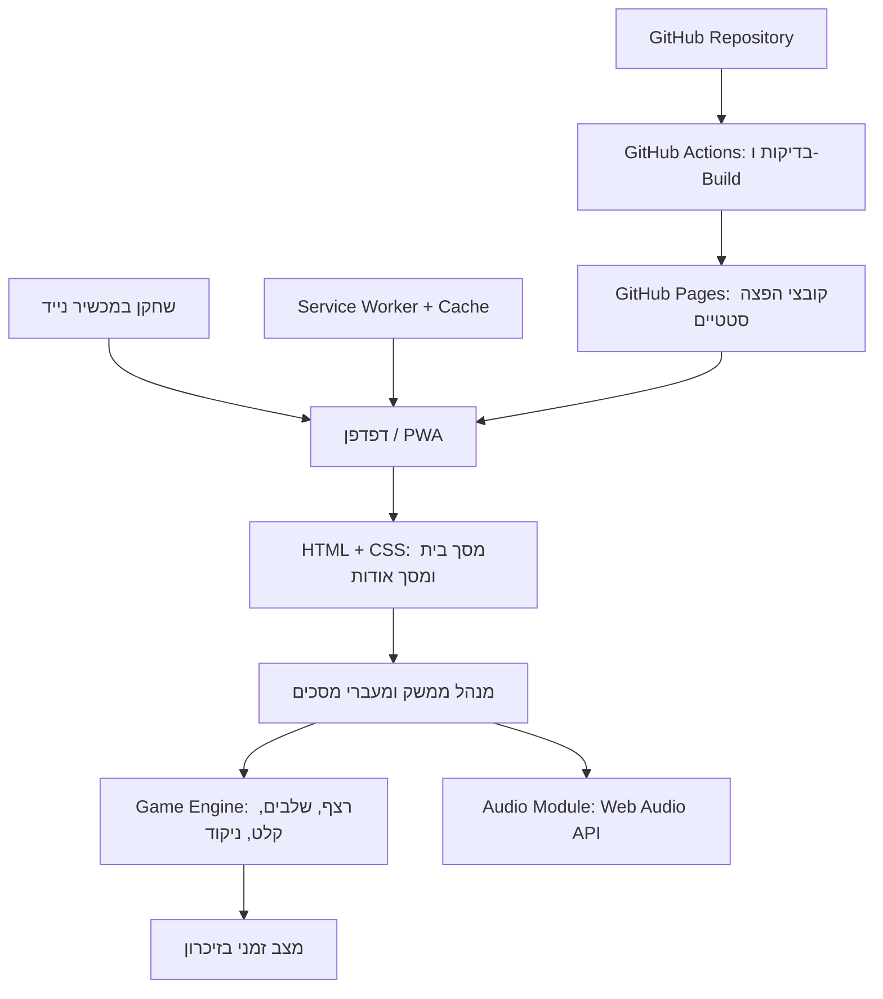

# ARCHITECTURE.md — משחק Simon

## 1. Technology Stack שנבחר

### 1.1 סיכום הבחירה

המערכת תמומש כאפליקציית Frontend סטטית, ללא Backend, Database, Authentication או שירותי צד שלישי בזמן הריצה. המשחק אינו דורש שרת: כללי המשחק, יצירת הרצפים, השמע והניקוד מתבצעים בדפדפן. הבחירה מצמצמת עלויות, נקודות כשל ותחזוקה, ומתאימה להיקף המצומצם של המוצר.

| תחום | טכנולוגיה | תפקיד |
|---|---|---|
| שפת פיתוח | TypeScript | מימוש לוגיקת המשחק עם בדיקות טיפוסים בזמן Build. |
| Build tool ושרת פיתוח | Vite | פיתוח מקומי, bundling ויצירת קובצי הפצה סטטיים. |
| UI | HTML סמנטי ו־CSS רגיל | שני מסכי המוצר, לוח ארבעת הצבעים ועיצוב Mobile-first. |
| State management | מודול TypeScript ייעודי | ניהול מצב המשחק בזיכרון בלבד; אין צורך בספריית State חיצונית. |
| Audio | Web Audio API | יצירת ארבעה צלילים ייחודיים בדפדפן, ללא הורדת קובצי שמע. |
| PWA ו־Offline | `vite-plugin-pwa` עם Workbox | יצירת Web App Manifest, Service Worker ושמירת נכסי האפליקציה במטמון. |
| בדיקות לוגיקה | Vitest | בדיקות יחידה ללוגיקת המשחק, לניקוד ולמעברי המצבים. |
| ניהול קוד מקור | Git ו־GitHub | היסטוריית שינויים, ענפים ו־Pull Requests לפי הצורך. |
| CI/CD | GitHub Actions | התקנת תלויות, בדיקות, Build ופרסום אוטומטי. |
| Hosting | GitHub Pages | אירוח קובצי האתר הסטטיים באמצעות HTTPS. |
| Backend / Database / Authentication | לא נדרשים | אין נתונים משותפים, משתמשים רשומים או מידע שצריך לשמור בשרת. |

### 1.2 נימוקים לבחירות

- **TypeScript במקום JavaScript בלבד:** המשחק קטן, אך כולל מצבים ברורים כגון הצגת רצף, המתנה לקלט, השהיה וסיום. טיפוסים מפורשים מסייעים למנוע טעויות במעברי מצבים ובחישוב הניקוד. התיעוד הרשמי מתאר את יתרון ה־static type checking בזיהוי טעויות לפני הריצה ([TypeScript Handbook](https://www.typescriptlang.org/docs/handbook/2/basic-types)).
- **Vite במקום כלי Build מורכב יותר:** מספק Build סטטי פשוט ומתועד, ללא צורך ב־Server-Side Rendering או בשרת יישומי. מדריך Vite מתאר במפורש פריסה ל־GitHub Pages באמצעות Build ו־GitHub Actions ([Vite: Static Deployment](https://vite.dev/guide/static-deploy.html)).
- **HTML/CSS ו־TypeScript ללא React/Vue:** יש רק שני מסכים ומעט אינטראקציות. Vanilla TypeScript מפחית תלויות ומורכבות. React הוא חלופה בשלה עם מודל רכיבים ותיעוד עשיר, אך מוסיף שכבת UI שאינה נחוצה בהיקף זה ([React: Installation](https://react.dev/learn/installation)). Vue או Svelte הן חלופות אפשריות, אך אינן פותרות צורך שאינו מכוסה בפתרון הפשוט.
- **`vite-plugin-pwa` במקום Service Worker ידני:** מחבר את תהליך ה־Build של Vite ליצירת Manifest ו־Service Worker עם precaching. הפרויקט מתעד תמיכה ב־offline וב־Workbox ([vite-plugin-pwa](https://github.com/vite-pwa/vite-plugin-pwa)).
- **Web Audio API במקום ספריית שמע:** נדרשים ארבעה צלילים פשוטים בלבד. API מובנה מאפשר ליצור אותם באמצעות oscillators ללא קובצי מדיה או תלות נוספת. ה־API מוגדר כזמין באופן נרחב, אך יש להפעיל או לחדש את `AudioContext` בעקבות פעולת משתמש, בהתאם למדיניות הדפדפנים ([MDN: Web Audio API](https://developer.mozilla.org/en-US/docs/Web/API/Web_Audio_API), [MDN: Autoplay](https://developer.mozilla.org/en-US/docs/Web/Media/Guides/Autoplay)).
- **GitHub Pages במקום Vercel:** מכיוון שאין Backend או API server, GitHub Pages הוא יעד הפריסה הישיר והפשוט יותר. GitHub Pages מארח HTML, CSS ו־JavaScript סטטיים מתוך Repository ([GitHub Pages](https://docs.github.com/en/pages/getting-started-with-github-pages/what-is-github-pages)). Vercel הוא חלופה אפשרית, אך יכולות full-stack שלו אינן נדרשות כאן.
- **ללא Database או Authentication:** כל המידע הוא מצב משחק זמני ותוצאת המשחק האחרון בזיכרון. אין הצדקה להוסיף Supabase, מסד נתונים, API או מנגנון משתמשים.

### 1.3 חלופות שנבחנו בקצרה

| תחום | חלופות רלוונטיות | החלטה |
|---|---|---|
| שכבת UI | Vanilla TypeScript; React; Vue/Svelte | Vanilla TypeScript בשל שני מסכים ומורכבות נמוכה. React/Vue/Svelte יישקלו רק אם היקף הממשק יגדל משמעותית. |
| Build | Vite; Parcel; כלי bundling ידניים | Vite בזכות תיעוד פריסה ישיר, תהליך Build נפוץ ואינטגרציה ל־PWA. |
| PWA | `vite-plugin-pwa`; Service Worker ידני; ללא PWA | `vite-plugin-pwa` כדי לצמצם קוד תשתיתי; Service Worker ידני אפשרי אך דורש תחזוקה נוספת. ללא PWA אינו עומד בדרישה. |
| Hosting | GitHub Pages; Vercel; Cloudflare Pages | GitHub Pages עבור אתר סטטי, פריסה מתוך GitHub ועלות תפעול נמוכה. |
| Audio | Web Audio API; קובצי audio; Howler.js/Tone.js | Web Audio API עבור ארבעה צלילים פשוטים; ספרייה חיצונית אינה מוצדקת. |
| Data | זיכרון Frontend; localStorage; Database בענן | זיכרון Frontend בלבד, לפי דרישת איפוס ברענון. |

### 1.4 עלויות, בשלות וסיכונים

- **עלות תשתית:** אין צורך בשירותי Backend או Database בתשלום. GitHub Pages ו־GitHub Actions זמינים בתוכנית Free בכפוף למכסות ולתנאי GitHub; יש לבדוק את התנאים העדכניים לפני פרסום. [GitHub Pricing](https://github.com/pricing).
- **מגבלות GitHub Pages:** האתר חייב להיות סטטי. בתיעוד GitHub מצוינות מגבלות שימוש, לרבות גודל אתר מפורסם של עד 1 GB ומגבלות רוחב פס/קצב שימוש. היקף המשחק צפוי להיות קטן בהרבה, אך Pages אינו מיועד לכל סוג של שירות מסחרי או SaaS. [GitHub Pages limits](https://docs.github.com/en/pages/getting-started-with-github-pages/github-pages-limits).
- **נתיב פריסה:** אם האתר מתפרסם תחת `https://<user>.github.io/<repository>/`, יש להגדיר ב־Vite את `base` לנתיב Repository ולוודא שגם Manifest ו־Service Worker משתמשים בנתיבים הנכונים. בדומיין משתמש או בדומיין מותאם `base` יהיה בדרך כלל `/`. [Vite deployment guide](https://vite.dev/guide/static-deploy.html).
- **Offline:** המשחק יעבוד Offline לאחר שה־Service Worker הותקן והנכסים נשמרו במטמון בהצלחה. ביקור ראשון ללא רשת אינו יכול להבטיח הורדה של נכסים שלא נשמרו קודם. Service Workers ו־Cache API הם המנגנון המקובל למטרה זו ([MDN: Offline operation](https://developer.mozilla.org/en-US/docs/Web/Progressive_web_apps/Guides/Offline_and_background_operation)).
- **שמע:** דפדפנים עשויים לחסום השמעת שמע לפני אינטראקציה של המשתמש. יש ליצור או לחדש `AudioContext` מתוך אירוע הלחיצה על «התחל», ולטפל בכשל השמעה בלי להשבית את החיווי החזותי ([MDN: Autoplay guide](https://developer.mozilla.org/en-US/docs/Web/Media/Guides/Autoplay)).
- **עדכוני PWA:** לאחר פריסת גרסה חדשה, Service Worker עשוי להמשיך לשרת גרסה שמורה עד להפעלת העדכון. יש לבחור מדיניות עדכון מפורשת ולבדוק אותה כדי להימנע מערבוב קובצי גרסאות.
- **דפדפנים:** יש לבדוק התקנה, Offline ושמע בגרסאות עדכניות של Chrome ו־Safari לנייד. התקנת PWA והצגת בקשת התקנה משתנות לפי דפדפן ומערכת הפעלה; יש לאפשר גם שימוש רגיל דרך הדפדפן.

## 2. ארכיטקטורת המערכת

### 2.1 מבנה כללי

המערכת היא Single Page Application קטנה, המוגשת כקובצי Static Hosting. אין תקשורת עם Backend ואין שירותים חיצוניים בזמן משחק.



### 2.2 Modules ושכבות לוגיות

#### UI Layer

אחריות:
- הצגת מסך הבית עם לוח ארבעת הצבעים, השלב הנוכחי, הניקוד/הודעות המשחק ולחצן «התחל».
- הצגת מסך «אודות» עם תיאור המשחק, הוראות, הסבר הצבעים והצלילים ותוצאת המשחק האחרון.
- הצגת הודעת כישלון או ניצחון עם הניקוד הסופי ולחצן «התחל מחדש».
- ניהול ניווט בין שני המסכים בלבד.
- חסימת לחיצות בזמן הצגת הרצף ובמצבים שבהם קלט אינו מותר.

#### Game Engine

מודול לוגיקה טהור ככל האפשר, ללא תלות ב־DOM או ב־Audio API. אחריות:
- יצירת צבע אקראי והוספתו לרצף.
- מעקב אחר מספר השלב ואינדקס הקלט של השחקן.
- בדיקת לחיצה מול הצבע המצופה.
- הוספת נקודה עבור כל לחיצה נכונה.
- מעבר בין המצבים: `ready`, `showing-sequence`, `awaiting-input`, `paused`, `won`, `lost`.
- סיום מיידי על קלט שגוי וניצחון לאחר השלמת שלב 10.
- חישוב מהירות הצגת הרצף לפי פונקציה קבועה מראש: הקצב עולה בהדרגה עד גבול מוגדר, ואז נשאר קבוע. הערכים המדויקים ייקבעו במימוש, מאחר שלא הוגדרו ב־PRD.

#### Audio Module

- יצירת `AudioContext` יחיד ושימוש חוזר בו.
- הגדרת תדר/צליל שונה לכל אחד מארבעת הצבעים.
- הפעלת הצליל מתוך רצף המשחק או בעקבות לחיצה נכונה של המשתמש.
- הפעלה או `resume()` של הקשר השמע בעקבות לחיצה מפורשת על «התחל».
- אם השמע נכשל או נחסם, המשחק ימשיך עם חיווי חזותי; לא ייווצר מצב שבו כשל שמע עוצר את לוגיקת המשחק.

#### PWA / Offline Module

- Web App Manifest עם שם האפליקציה, שפת ממשק עברית, צבעי מעטפת ואייקונים מתאימים.
- Service Worker שנוצר באמצעות `vite-plugin-pwa`/Workbox.
- שמירת קובצי ה־HTML, JavaScript, CSS, Manifest והאייקונים הנדרשים במטמון precache.
- אין צורך ב־runtime caching עבור APIs, משום שאין APIs חיצוניים.
- יש לבדוק שה־Service Worker והנכסים עובדים תחת נתיב GitHub Pages, ולא רק בנתיב `/`.

### 2.3 מודל נתונים ואחסון

אין ישויות שרת ואין Database.

| נתון בזיכרון | תיאור | אורך חיים |
|---|---|---|
| `currentSequence` | רצף הצבעים של המשחק הנוכחי | עד סיום המשחק או רענון |
| `currentLevel` | השלב הנוכחי, 1–10 | עד סיום המשחק או רענון |
| `inputIndex` | מיקום הלחיצה הבאה של השחקן ברצף | עד מעבר שלב/סיום/רענון |
| `score` | מספר הלחיצות הנכונות במשחק הנוכחי | עד סיום המשחק או רענון |
| `gameStatus` | מצב המשחק הנוכחי | עד סיום המשחק או רענון |
| `lastCompletedScore` | הניקוד של המשחק האחרון שהסתיים | עד רענון הדף |
| `lastResult` | תוצאת המשחק האחרון: ניצחון או כישלון | עד רענון הדף |
| `pausedState` | מצב זמני הנדרש להמשך משחק לאחר מעבר למסך «אודות» | עד חזרה למשחק או רענון |

אין להשתמש ב־`localStorage`, ב־IndexedDB או ב־Cookies לשמירת ניקוד או מצב משחק, משום שה־PRD דורש איפוס לאחר רענון ואינו דורש שמירה מתמשכת. Cache של קובצי האפליקציה לצורך Offline הוא תשתיתי ואינו נחשב לשמירת נתוני משחק.

### 2.4 Data Flow – זרימת מידע

#### התחלת משחק
1. המשתמש לוחץ על «התחל».
2. ממשק המשתמש מבקש ממודול השמע להפעיל/לחדש את `AudioContext` בעקבות פעולת המשתמש.
3. Game Engine מאפס את מצב המשחק, הניקוד והרצף הזמני.
4. נבחר צבע אקראי אחד לשלב הראשון.
5. ה־UI מציג את הצבע וה־Audio Module מנגן את הצליל המתאים.
6. לאחר הצגת הרצף, מצב המשחק משתנה ל־`awaiting-input`.

#### קלט נכון
1. המשתמש לוחץ על אזור צבע.
2. ה־UI מעביר את מזהה הצבע ל־Game Engine.
3. Game Engine בודק את הצבע מול `currentSequence[inputIndex]`.
4. אם נכון, הניקוד גדל בנקודה אחת והאינדקס מתקדם.
5. כאשר כל הרצף הוזן נכון, אם השלב קטן מ־10 מתווסף צבע אקראי ומתחיל שלב חדש.
6. לאחר השלמת רצף של שלב 10, המשחק מסתיים בניצחון.

#### קלט שגוי וסיום
1. Game Engine מזהה אי־התאמה.
2. המשחק עובר ל־`lost` והקלט נחסם.
3. `lastCompletedScore` ו־`lastResult` מתעדכנים.
4. ה־UI מציג הודעת כישלון, את הניקוד הסופי ולחצן «התחל מחדש».

#### מסך «אודות»
1. במעבר למסך «אודות», ה־UI שומר בזיכרון את מצב המשחק הדרוש ומפסיק timers פעילים.
2. מסך «אודות» מציג את `lastCompletedScore` או «אין עדיין תוצאה» אם אין תוצאה קודמת.
3. בחזרה למסך הבית, המערכת משחזרת את מצב המשחק וממשיכה ממנו. אין לקדם את הרצף או להוסיף נקודות בזמן שהמשחק מושהה.

#### רענון
רענון טוען מחדש את האפליקציה ומאתחל את כל מצב המשחק והניקוד. אין מנגנון שחזור של משחק קודם.

### 2.5 APIs ואינטגרציות

- אין API פנימי או חיצוני.
- אין Backend, Authentication, Authorization או Database.
- אין אינטגרציות עם שירותי צד שלישי בזמן הריצה.
- ממשקי הדפדפן היחידים הנדרשים מעבר ל־DOM הם Web Audio API, Service Worker, Cache API ויכולות התקנת PWA.

### 2.6 אבטחה ופרטיות

- אין איסוף מידע אישי ואין חשבונות משתמשים.
- אין סודות או API keys בצד לקוח.
- יש לפרסם את האתר באמצעות HTTPS. GitHub Pages תומך ב־HTTPS, ויש לוודא שהאכיפה מופעלת בהגדרות האתר ([GitHub: Securing Pages with HTTPS](https://docs.github.com/en/pages/getting-started-with-github-pages/securing-your-github-pages-site-with-https)).
- יש לצמצם הרשאות `GITHUB_TOKEN` ב־GitHub Actions להרשאות הנדרשות לפרסום בלבד.
- יש לקבע גרסאות תלויות באמצעות lockfile ולהריץ `npm ci` ב־CI.
- מאחר שאין Backend, אין צורך ב־Authorization או ב־RLS.

### 2.7 GitHub, Build ו־Deployment

#### מבנה Repository מוצע

```text
/
├── public/
│   ├── icons/
│   └── (נכסים סטטיים נוספים לפי הצורך)
├── src/
│   ├── main.ts
│   ├── styles/
│   ├── ui/
│   ├── game/
│   └── audio/
├── tests/
├── index.html
├── vite.config.ts
├── package.json
├── package-lock.json
├── tsconfig.json
├── vitest.config.ts
├── .github/
│   └── workflows/
│       └── deploy.yml
├── PRD.md
└── ARCHITECTURE.md
```

המבנה הוא הצעה לוגית; ניתן לשנות שמות קבצים בלי לשנות את הארכיטקטורה.

#### תהליך CI/CD

1. קוד המקור נשמר ב־GitHub Repository.
2. Push לענף הראשי מפעיל GitHub Actions.
3. ה־Workflow מתקין גרסת Node.js נתמכת ותלויות באמצעות `npm ci`.
4. מופעלות בדיקות Vitest ובדיקת TypeScript/Build.
5. אם הבדיקות וה־Build מצליחים, Vite יוצר את קובצי ההפצה בתיקיית `dist/`.
6. GitHub Actions מפרסם את `dist/` באמצעות GitHub Pages.
7. אם שלב הבדיקות או ה־Build נכשל, אין לפרסם את הגרסה שנכשלה.

יש להשתמש ב־GitHub Pages עם GitHub Actions כמקור הפרסום. יש להגדיר את `base` של Vite לפי כתובת הפרויקט, ולבדוק את הנתיבים של Manifest ו־Service Worker. מדריך Vite כולל תהליך פריסה זה ודוגמת Workflow רשמית: [Vite Static Deployment](https://vite.dev/guide/static-deploy.html).

#### Development ו־Production

- **Development:** סביבת פיתוח מקומית עם Vite, תוך שימוש בנתונים זמניים בזיכרון. אין סביבת Backend או Database.
- **Production:** הקבצים הסטטיים שנבנו ונפרסו ב־GitHub Pages.
- אין פרטי גישה של שירותי Production לשמור, משום שלא נעשה שימוש בשירותים כאלה. הרשאות GitHub Actions מוגבלות ל־Build ולפרסום.
- אין צורך בשני פרויקטים ב־Supabase, משום ש־Supabase ומסד נתונים אינם נדרשים למוצר.

### 2.8 תצורה וגרסאות

- גרסת Node.js לפיתוח ול־CI תהיה גרסת LTS נתמכת התואמת לגרסת Vite ולגרסת `vite-plugin-pwa` שנבחרו בעת המימוש.
- יש לשמור `package-lock.json` ב־Repository.
- אין להכניס סודות לקובצי התצורה או לקוד.
- הגדרות PWA, נתיב הפרסום, צבעי המעטפת ואייקונים ינוהלו בקובצי הפרויקט.
- יש לקבע גרסאות Actions חיצוניים לפי SHA מלא, או לעדכן אותם באופן מבוקר, בהתאם להמלצות האבטחה של GitHub.

### 2.9 בדיקות ואיכות

Vitest ישמש לבדיקות יחידה של לוגיקת המשחק, ללא תלות ב־DOM:
- יצירת רצף התחלתי והוספת צבע בכל שלב.
- אימות סדר הקלט של השחקן.
- ניקוד של נקודה אחת לכל לחיצה נכונה בלבד.
- סיום מיד לאחר לחיצה שגויה.
- ניצחון לאחר השלמת שלב 10.
- עצירת קלט בזמן הצגת רצף.
- השהיה והמשך לאחר מעבר למסך «אודות».
- איפוס מצב המשחק לאחר התחלה מחדש.

בנוסף, לפני פרסום יש לבצע בדיקה ידנית במכשירים ניידים של: ארבעת הצבעים, השמע, רענון, מעבר בין המסכים, התקנת PWA, הפעלה לאחר טעינה ראשונה במצב Offline ועדכון Service Worker לגרסה חדשה.

## 3. החלטות ארכיטקטוניות מרכזיות

1. **Frontend בלבד:** אין צורך בשרת, API או Database לפי דרישות המוצר.
2. **מצב בזיכרון בלבד:** כל מצב המשחק ותוצאת המשחק האחרון נמחקים ברענון; רק נכסי האפליקציה נשמרים ב־Cache לצורך Offline.
3. **Vanilla TypeScript:** נמנעת שכבת UI נוספת עבור ממשק קטן בעל שני מסכים.
4. **PWA באמצעות Vite plugin:** מפחית טיפול ידני ב־Service Worker וב־Manifest.
5. **GitHub Pages:** אירוח סטטי פשוט עם פריסה אוטומטית דרך GitHub Actions.
6. **אין Supabase:** לא קיימים נתונים מתמשכים או משתמשים שמצדיקים Database או Authentication.

## 4. מקורות

המקורות נבדקו לצורך הכנת ההמלצה בתאריך 18 באוקטובר 2026. גרסאות ומכסות שירות עשויות להשתנות, ויש לאמתן בעת הקמת הפרויקט.

1. [Vite — Deploying a Static Site](https://vite.dev/guide/static-deploy.html) — Build ופריסה ל־GitHub Pages.
2. [GitHub Docs — What is GitHub Pages?](https://docs.github.com/en/pages/getting-started-with-github-pages/what-is-github-pages) — יכולות אירוח סטטי.
3. [GitHub Docs — GitHub Pages limits](https://docs.github.com/en/pages/getting-started-with-github-pages/github-pages-limits) — מגבלות שימוש.
4. [GitHub Docs — Custom workflows](https://docs.github.com/en/pages/getting-started-with-github-pages/using-custom-workflows-with-github-pages) — פרסום באמצעות GitHub Actions.
5. [GitHub Docs — HTTPS for GitHub Pages](https://docs.github.com/en/pages/getting-started-with-github-pages/securing-your-github-pages-site-with-https) — אבטחת תעבורה.
6. [TypeScript Handbook — Basic Types](https://www.typescriptlang.org/docs/handbook/2/basic-types) — יתרונות בדיקת טיפוסים סטטית.
7. [React — Installation](https://react.dev/learn/installation) — חלופה לממשק מבוסס רכיבים.
8. [vite-plugin-pwa](https://github.com/vite-pwa/vite-plugin-pwa) — יצירת PWA, Service Worker ו־Offline cache.
9. [MDN — Making PWAs installable](https://developer.mozilla.org/en-US/docs/Web/Progressive_web_apps/Guides/Making_PWAs_installable) — דרישות התקנה ו־Manifest.
10. [MDN — Offline and background operation](https://developer.mozilla.org/en-US/docs/Web/Progressive_web_apps/Guides/Offline_and_background_operation) — Service Worker ו־Cache לצורך Offline.
11. [MDN — Web Audio API](https://developer.mozilla.org/en-US/docs/Web/API/Web_Audio_API) — יצירת שמע בדפדפן.
12. [MDN — Autoplay guide](https://developer.mozilla.org/en-US/docs/Web/Media/Guides/Autoplay) — מגבלות השמעת שמע לפני אינטראקציית משתמש.
13. [GitHub Pricing](https://github.com/pricing) — תוכניות ומכסות שירות.
