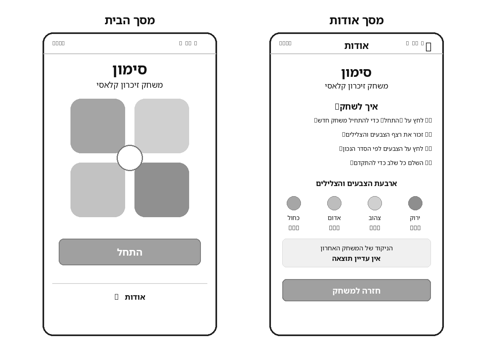
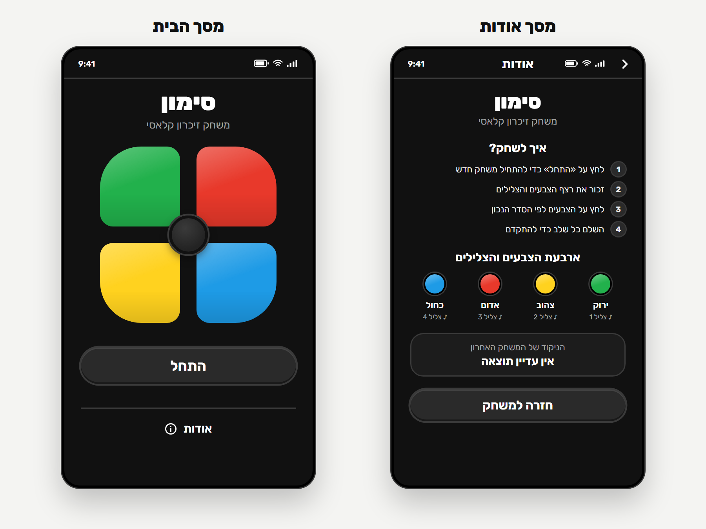
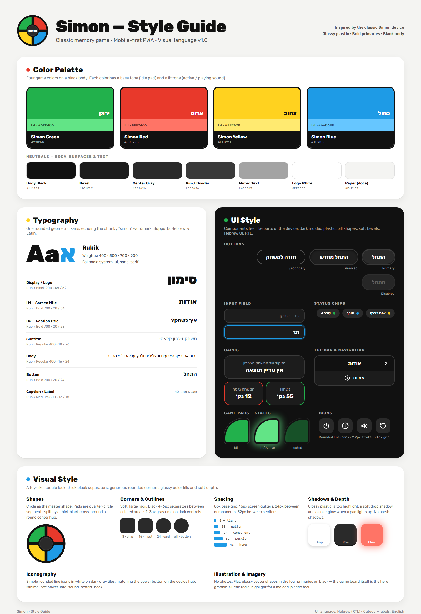

# Design (UI / UX)

> עיצוב האפליקציה, בשני חלקים: ה-**מסכים** (Screens) וה-**Style Guide**. המסמך מתבסס על `PRD.md` ועל שלוש תמונות הייחוס שבתיקייה זו. דרישות המוצר, ההתנהגות ועקרונות ה-UX מתועדים ב-PRD ואינם חוזרים כאן.

## 1. Screens – מסכי האפליקציה

### Wireframes (מבנה ופריסה)

### Mockups (המראה הסופי)

### רשימת המסכים
לאפליקציה שני מסכים בלבד. שניהם מוצגים כמסך טלפון במבנה עמודה אחת, ממורכז, על רקע כהה (Body Black).

#### מסך הבית
- **מטרת המסך:** לשחק במשחק — להתחיל משחק, לצפות ברצף ולשחזר אותו בלחיצה על אזורי הצבע.
- **מבנה ותוכן** (מלמעלה למטה):
  1. **שורת מצב** של המכשיר (שעה, קליטה, Wi-Fi, סוללה), מופרדת מהתוכן בקו Divider.
  2. **כותרת** «סימון» (Display) וכותרת משנה «משחק זיכרון קלאסי» (Subtitle, צבע Muted), ממורכזות.
  3. **לוח המשחק:** ארבעה אזורי צבע מרובעים בגריד 2×2 עם רווח ביניהם, ועיגול מרכזי (Hub) שחופף לפינות הפנימיות שלהם. סידור הצבעים ב-Mockups: ירוק למעלה-שמאל, אדום למעלה-ימין, צהוב למטה-שמאל, כחול למטה-ימין. הפינה החיצונית של כל אזור מעוגלת מאוד, ושלוש הפינות האחרות מעוגלות בעדינות; יחד הם יוצרים צורה עגולה בהשראת מכשיר Simon. ה-Hub ריק, בצבע Center Gray עם מסגרת Rim.
  4. **כפתור Primary** «התחל» ברוחב מלא של אזור התוכן.
  5. **קו Divider** אופקי.
  6. **קישור ניווט** «אודות» עם אייקון מידע (ⓘ), ממורכז.
- **פעולות וניווט:**
  - «התחל» — מתחיל משחק חדש.
  - לחיצה על אזור צבע — קלט של השחקן; בזמן הלחיצה או ההצגה האזור עובר למצב Lit (ראה Game pads ב-Style Guide).
  - «אודות» — מעבר למסך אודות.
- **מצבים שאינם מוצגים ב-Wireframes וב-Mockups:** ה-PRD דורש להציג את מצב המשחק, הודעת כישלון/ניצחון, ניקוד סופי ולחצן «התחל מחדש». ה-Wireframes וה-Mockups מראים רק את המצב ההתחלתי, ולכן מיקומם המדויק במסך לא הוגדר. רכיבי ה-Style Guide המתאימים להם: Status chips (למשל «צפה ברצף», «תורך», «שלב 4»), כרטיסי Win/Lose, וכפתור Primary «התחל מחדש». הנוסח הסופי של ההודעות טרם הוגדר ב-PRD.

#### מסך אודות
- **מטרת המסך:** לקרוא על המשחק ועל אופן המשחק, להכיר את הצבעים והצלילים ולראות את הניקוד של המשחק האחרון.
- **מבנה ותוכן** (מלמעלה למטה):
  1. **Top bar:** כותרת המסך «אודות» במרכז, כפתור חזרה (חץ ›) בצד ימין, והשעה וסמלי המצב בשורה זו.
  2. **כותרת** «סימון» וכותרת משנה «משחק זיכרון קלאסי», ממורכזות.
  3. **כותרת H2** «איך לשחק?» ומתחתיה רשימה ממוספרת של ארבעה צעדים, מיושרת לימין. כל מספר מוצג בעיגול קטן בצבע Center Gray:
     1. לחץ על «התחל» כדי להתחיל משחק חדש
     2. זכור את רצף הצבעים והצלילים
     3. לחץ על הצבעים לפי הסדר הנכון
     4. השלם כל שלב כדי להתקדם
  4. **כותרת H2** «ארבעת הצבעים והצלילים» ומתחתיה שורה של ארבעה פריטים, מימין לשמאל: ירוק, צהוב, אדום, כחול. כל פריט כולל עיגול צבע, שם הצבע ושורת Caption של הצליל («♪ צליל 1» עד «♪ צליל 4»). ב-Wireframes שורת הצליל מופיעה כסמל שלא הוגדר; ה-Mockups משתמשים בנוסח הזה כ-Placeholder.
  5. **כרטיס ניקוד:** תווית «הניקוד של המשחק האחרון» (Muted) וערך מודגש מתחתיה — «אין עדיין תוצאה» כשאין תוצאה.
  6. **כפתור Primary** «חזרה למשחק» ברוחב מלא של אזור התוכן.
- **פעולות וניווט:** «חזרה למשחק» או החץ ב-Top bar — חזרה למסך הבית.

### מבנה הניווט
ניווט שטוח בין שני מסכים, ללא תפריט, טאבים או היסטוריה מורכבת:
- **מסך הבית → מסך אודות:** קישור «אודות» בתחתית מסך הבית.
- **מסך אודות → מסך הבית:** כפתור «חזרה למשחק» או החץ ב-Top bar.

---

## 2. Style Guide – השפה העיצובית

האווירה הכללית: משחק-צעצוע מוחשי בהשראת מכשיר Simon הקלאסי — גוף פלסטיק שחור, ארבעה צבעי יסוד בוהקים ומבריקים, פינות מעוגלות ועומק עדין.

### Color Palette

**צבעי המשחק** — לכל צבע גוון Base (אזור במצב רגיל) וגוון Lit (אזור דולק / מנגן צליל):

| צבע / תפקיד | Base | Lit |
|-------------|------|-----|
| Simon Green — ירוק | `#22B14C` | `#62E486` |
| Simon Red — אדום | `#E8392B` | `#FF7466` |
| Simon Yellow — צהוב | `#FFD21F` | `#FFEA70` |
| Simon Blue — כחול | `#1E9BE6` | `#66C6FF` |

**Neutrals** — גוף, משטחים וטקסט:

| צבע / תפקיד | HEX | שימוש |
|-------------|-----|-------|
| Body Black | `#111111` | רקע המסכים, מסגרות הפרדה בין אזורי צבע |
| Bezel | `#1C1C1C` | רקע כרטיסים ושדות |
| Center Gray | `#2A2A2A` | כפתורים, ה-Hub, אריחי אייקונים, עיגולי מספרים |
| Rim / Divider | `#3A3A3A` | מסגרות של רכיבים כהים, קווי הפרדה |
| Muted Text | `#A3A3A3` | כותרות משנה, תוויות, Caption |
| Logo White | `#FFFFFF` | טקסט ראשי ואייקונים |
| Paper | `#F4F4F2` | רקע מסמכי העיצוב בלבד (לא חלק מהאפליקציה) |

### Typography
- **גופן:** Rubik (תומך בעברית ובלטינית); Fallback: `system-ui, sans-serif`. משקלים: 400, 500, 700, 900.
- **היררכיה** (גודל / גובה שורה, ב-px):

| רמה | משקל | גודל / שורה | דוגמה |
|-----|------|-------------|-------|
| Display / Logo | Black 900 | 48 / 52 | סימון |
| H1 — כותרת מסך | Bold 700 | 28 / 34 | אודות |
| H2 — כותרת סעיף | Bold 700 | 20 / 28 | איך לשחק? |
| Subtitle | Regular 400 | 18 / 26 | משחק זיכרון קלאסי |
| Body | Regular 400 | 16 / 24 | טקסט ההוראות |
| Button | Bold 700 | 20 / 24 | התחל |
| Caption / Label | Medium 500 | 13 / 18 | שלב 3 מתוך 10 |

### UI Style
- **כפתורים:** צורת Pill (פינות מעוגלות לגמרי), גובה כ-56px, טקסט Button בלבן.
  - *Primary:* רקע Center Gray, מסגרת Rim של 3px, הדגשה עליונה עדינה וצל פנימי תחתון (Bevel).
  - *Pressed:* רקע כהה יותר וצל פנימי שקוע.
  - *Secondary:* רקע שקוף עם קו מתאר אפור של 2px.
  - *Disabled:* רקע וטקסט אפורים-כהים, ללא ניגודיות.
- **אזורי המשחק (Game pads):** שלושה מצבים —
  - *Idle:* צבע Base.
  - *Lit / Active:* צבע Lit עם זוהר (Glow) בצבע האזור.
  - *Locked:* צבע Base בשקיפות מופחתת — כשאסור ללחוץ (למשל בזמן הצגת הרצף).
- **כרטיסים:** רקע Bezel, מסגרת Rim של 2px, רדיוס 22–24px, טקסט ממורכז: תווית Muted מעל ערך מודגש. כרטיסי תוצאה: מסגרת ירוקה לניצחון ומסגרת אדומה לכישלון.
- **שדות קלט:** רקע Bezel, מסגרת Rim, רדיוס 16px; במצב Focus — מסגרת כחולה עם הילה. *(מופיעים ב-Style Guide בלבד; אין שדות קלט במסכי האפליקציה.)*
- **Status chips:** Pill קטן ברקע Center Gray עם נקודת צבע ותווית.
- **Top bar וניווט:** שורה עליונה ברקע Body Black עם קו Divider תחתון, כותרת ממורכזת וחץ חזרה. קישור ניווט: טקסט עם אייקון, ממורכז.
- **אייקונים:** קו מעוגל (Line icons), עובי קו 2.2px, גריד 24px, בלבן. כשהם עומדים בפני עצמם — על אריח Center Gray מעוגל. הסט: הפעלה (Power), מידע (Info), צליל, התחלה מחדש, חזרה.

### Visual Style
- **צורות:** העיגול הוא הצורה המרכזית — לוח המשחק עגול באופיו, עם Hub עגול במרכז ועיגולי צבע במסך אודות.
- **פינות (רדיוסים):** 8px ל-Chips, 16px לשדות, 24px לכרטיסים, Pill לכפתורים; פינה חיצונית גדולה באזורי המשחק; כ-30px למסגרת מסך הטלפון.
- **קווי מתאר:** מסגרות שחורות עבות (4–6px) מפרידות בין אזורים צבעוניים; מסגרות Rim אפורות (2–3px) סביב רכיבים כהים.
- **צללים ועומק:** מראה פלסטיק מבריק — הדגשה עליונה (Highlight) וצל רך; Bevel בכפתורים; Glow צבעוני כשאזור נדלק. ללא צללים חדים.
- **מרווחים (Spacing):** גריד בסיס של 8px — 8 צפוף, 16 שוליים צדדיים של המסך, 24 בין רכיבים, 32 בין סעיפים, 48 לאזור ראשי.
- **Layout ויישור:** Mobile-first, עמודה אחת. כותרות, לוח המשחק, כפתורים וכרטיסים ממורכזים; כפתורים ראשיים ברוחב מלא של אזור התוכן; רשימות טקסט מיושרות לימין.
- **תמונות ואיורים:** ללא צילומים. צורות וקטוריות שטוחות ומבריקות בארבעת צבעי היסוד על רקע שחור — לוח המשחק עצמו הוא הגרפיקה המרכזית.

### שפה וכיווניות
- שפת הממשק: עברית בלבד; כיווניות RTL (`dir="rtl"`, `lang="he"`).
- טקסט רץ ורשימות מיושרים לימין; כותרות, כפתורים וכרטיסים ממורכזים.
- כפתור החזרה ב-Top bar נמצא בצד ימין, והחץ שלו מצביע ימינה (›).
- שורת הצבעים במסך אודות נקראת מימין לשמאל: ירוק, צהוב, אדום, כחול.
- לוח המשחק אינו מתהפך ב-RTL; סידור הצבעים בו קבוע כפי שמופיע ב-Mockups.
